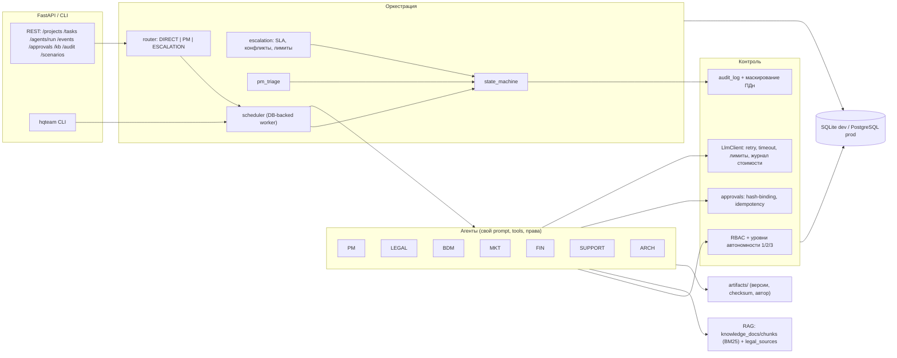

# Архитектура HQTeam AI company OS

## 1. Обзор

Система — операционный контур ИИ-компании, а не набор чат-ботов. Семь ролевых агентов работают через
общую БД: задачи, сообщения, артефакты, одобрения и аудит. Агенты не общаются «в чате»: каждая передача
— запись `agent_messages` и задача `tasks` со статусом и зависимостями.



## 2. Дерево файлов

```
hqteam/
  app/
    core/            config.py db.py models.py security.py logging.py audit.py llm.py
    agents/          base.py pm.py legal.py bdm.py mkt.py fin.py support.py arch.py registry.py
    agents/prompts/  pm.md legal.md bdm.md mkt.md fin.md support.md arch.md
    orchestration/   router.py state_machine.py scheduler.py escalation.py messages.py projects.py
    api/             main.py
    tools/           artifacts.py pricing.py tax.py planning.py diagram.py validation.py
    knowledge/       store.py (ingest/chunk/BM25) citations.py legal_sources.py
    approvals/       service.py
    cli.py
  db/                migrations/ (Alembic, 0001_initial_schema) seed.py
  knowledge_base/    pm legal bdm mkt fin support arch  (внутренние материалы + реестр источников)
  scenarios/         runner.py data/*.json (синтетика)
  tests/             9 файлов pytest
  docs/              ARCHITECTURE.md ADR.md RUNBOOK.md REPORT.md
  .env.example docker-compose.yml Dockerfile Makefile README.md
```

Модуль `tools/email` из ТЗ реализован как инструмент `email.draft` в `Ctx`: черновик письма сохраняется
артефактом, функции отправки у агентов нет вообще. Отправка — только `approvals.execute` после решения
человека.

## 3. Схема данных

Минимальная схема из ТЗ реализована полностью; добавлены таблицы, без которых требования не выполнить:

| Таблица | Назначение |
|---|---|
| projects, clients, tasks, agent_messages, leads, quotes, contracts, invoices, incidents, artifacts, knowledge_docs, approvals, audit_log | по ТЗ |
| icp_segments | ICP и сегменты от MKT (шаг 1 сценария 1) |
| knowledge_chunks | фрагменты для RAG с токенами BM25 |
| external_operations | журнал внешних операций, `idempotency_key UNIQUE` |
| llm_calls | журнал стоимости LLM, основа лимитов на задачу |
| decisions | реестр решений PM |
| open_questions | вопросы клиенту/людям: NOT_VERIFIED, NEEDS_VERIFICATION, CONSENT… |
| principals | люди/сервисы API, роли, SHA-256 хэш ключа |

Статусы задачи: `BACKLOG → ASSIGNED → IN_PROGRESS → REVIEW → APPROVED / CHANGES_REQUESTED → DONE`, плюс
`BLOCKED` и `ESCALATED`. Переходы заданы явно в `orchestration/state_machine.py`, каждый пишется в аудит.

## 4. Маршрутизация (раздел 3 ТЗ)

| Условие | Режим | Статус новой задачи | Сообщения |
|---|---|---|---|
| флаги `touches_budget, external_send, production_infra, client_document, scope_change, security_risk, role_conflict` | ESCALATION | ESCALATED | ESCALATION → PM (needs_human) |
| задачу ставит PM | PM | ASSIGNED | REQUEST → исполнителю |
| пара не в `direct_targets` агента | PM | BACKLOG | REQUEST → PM |
| крупный проект и вид работы не из `DIRECT_ROUTINE_KINDS` | PM | BACKLOG | REQUEST → PM |
| иначе (мелкая рутинная, разрешённая пара) | DIRECT | ASSIGNED | REQUEST → исполнителю, NOTIFY → PM |

`pm_triage` на каждом шаге воркера назначает BACKLOG-задачи. Эскалации `client_document/external_send`
PM принимает сам, потому что само внешнее действие всё равно закрыто approval-гейтом. Остальные эскалации
(бюджет, безопасность, scope, застой по SLA, исчерпанные лимиты, противоречие ролей) уходят людям: open
question для MANAGEMENT.

## 5. Выполнение задачи

1. `scheduler.is_ready` — зависимости в DONE, для `wait_for_project` ещё и все прочие задачи проекта.
2. `run_task`: лимит попыток → `IN_PROGRESS` → `agent.execute(ctx)` внутри SAVEPOINT.
3. Исключения: `MissingData` → BLOCKED + вопросы (агент не выдумывает); `BudgetExceeded`,
   `PermissionDenied`, `LlmRefused`, `Escalate` → ESCALATED.
4. Успех → RESULT заказчику задачи → ревью по контракту результата агента (ревьюер PM или заказчик при
   DIRECT) → APPROVED → DONE или CHANGES_REQUESTED.

## 6. LLM

`LlmClient` — единая точка: таймаут, `max_retries`, потолок `max_tokens`, лимит вызовов и стоимости на
задачу (по `llm_calls`), журнал токенов/стоимости, обработка `stop_reason == "refusal"`, server-side
fallbacks. Структурные данные (суммы, статусы, ссылки на источники) считают инструменты; модель пишет
только пояснительный текст (`ctx.narrate`). Поэтому offline-режим даёт полностью воспроизводимые сценарии.
